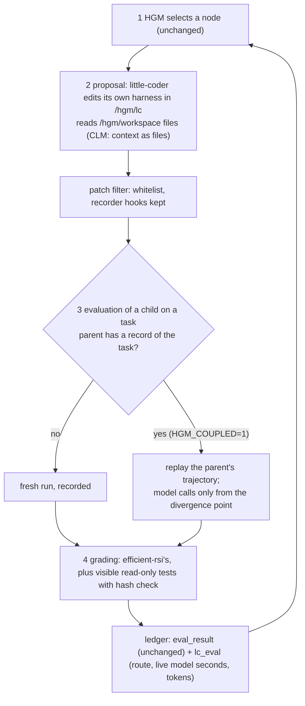

# harness-rsi on efficient-rsi: little-coder as the self-improving agent, with coupled evaluation

Written 2026-11-16. Branch `harness-rsi`. Not run yet: everything below was written and syntax-checked
on a laptop; the first run is `scripts/lc_smoke.py` on the GPU host (section 5).

## 1. What changes and what does not

**HGM's search is unchanged.** Thompson-sampling selection, expansion, node stopping (ERL), the final
choice and the held-out evaluation are efficient-rsi's code. Two things are replaced: the agent that
is evaluated and improved, and how one evaluation is run. All of it is off unless `HGM_AGENT=littlecoder`,
so the original arms (`hgm-fixed`, `hgm-erlx`, `dgm`) run as before.



| Component | Where | Replaces / adds |
|---|---|---|
| Agent = little-coder | `lc/` (vendored, `scripts/vendor_littlecoder.sh`), entry `lc/hgm_agent.py` | `coding_agent_polyglot.py`. Same command line and outputs (`model_patch.diff`, chat log, exit 0) |
| Patch whitelist and contract | `lc_integration.filter_patch` | A proposal may change only `harness_knobs.json`, `ctx_policy.py`, `context.py`, `compaction.py`, `agent.py`, `tools.py`, `local/*.py`, `skill/*`. `hgm_agent.py`, `rsi_record.py`, `providers.py`, `tool_registry.py`, `config.py` are frozen. A patch that removes a recorder or context-policy hook is rejected |
| Knobs | `lc/harness_knobs.json` | Typed values the proposer is told to change first: `tool_result_max_chars`, `keep_tool_rounds`, `compress_test_output`, `max_turns`, `max_turns_self_improve`. Keeps a weak proposer's action space small |
| Proposer workspace (CLM) | `lc_integration.build_workspace`, `proposer_instruction` | The diagnosis prompt with pasted logs (v1 lost 39-99% of proposals to over-long prompts). The proposer gets a short instruction and opens files: `digest.md` (per-task result and failure class computed by code), `trajectories/`, `tests/`, `patch_ledger.jsonl` (every earlier node: files changed, score), `ancestor_patches/`. `HGM_LC_DIAGNOSE=1` also appends efficient-rsi's diagnosis |
| Coupled evaluation | `polyglot/harness.py: process_entry_lc`, `lc/rsi_record.py` | `eval_agent` ran every evaluation from scratch. Now each evaluation records every model call; a child evaluated on a task its parent has a record of replays it and calls the model only from the first differing request. Routes: `d0` (no divergence: no model call, the outcome is re-graded for real), `fork` (divergence at call k > 0), `fork0` (k = 0, same cost as fresh), `fresh` (no parent record). The child's record is complete (served + live calls), so coupling chains down the tree |
| Task choice for coupling | `hgm.py` (`HGM_COUPLED_TASKS=1`) | Among the tasks a node has not done, HGM's order is kept but tasks its parent has a record of come first |
| Test protocol | `process_entry_lc` | `HGM_HIDE_ANSWERS=1` is forced (no reference solution in the container). New: the task's tests are copied into `/testbed`, read-only (`chmod 444`), sha256 before and after; a changed hash grades the attempt unresolved. Web tools are off (`LC_DISABLE_TOOLS`); Bash commands with curl/wget/git clone/URLs are logged (`guard` in `<task>_rsi.json`) |
| Replay determinism | `lc/rsi_record.py` | Masks for test durations, timestamps, `ls -l` times and owners, object addresses and ids; cut calls at the turn cap; compaction summaries replayed from the next recorded request; per-task memory reset is automatic (fresh container) |
| Cost accounting | `lc_integration.record_cost`, ledger event `lc_eval` | Per evaluation: live calls, served calls, model seconds, prompt / cached / output tokens, `uncached_in_plus_out` (prefix-reuse accounting). HGM's own GPU-occupancy hours are unchanged |

What it does **not** do: it does not change how HGM picks nodes or the final agent; it does not
train any model; ERL's patch features (`instrumentation/prescreen/predict_from_diff.py`) still look for
DGM file names, so `hgm-lc-coupled-erlx` runs with an uninformed predictor prior.

## 1b. Lineage notes (`notes.md`) and how they are corrected

Each node has its own `notes.md`. A proposer reads its parent's notes in `/hgm/workspace/notes.md`,
may rewrite them (one Log entry per change, with a checkable prediction; a Summary), and its version
becomes the child's notes. There is no global notebook and no explicit rollback:

- **Selection prunes.** HGM's Thompson sampling rarely expands a weak node, so its notes rarely reach
  later proposers. Notes are inherited like the code: a lineage keeps the notes of the versions it is
  made of.
- **Evidence is separate and written by code.** `lineage_evidence.md` (read-only to the proposer)
  lists every change from the root to the parent: files changed, the child's solve rate minus its
  parent's on the tasks both were evaluated on, the paired standard error, and a verdict (`better` /
  `worse` at 2 standard errors, `unclear`, or `too few shared tasks` below 5). The proposer is told that
  notes are hypotheses and that a `worse` change means its idea did not work. With
  `HGM_COUPLED_TASKS=1`, children are evaluated on their parent's tasks first, so more tasks are shared.
- **Capacity.** A child inherits at most `HGM_LC_NOTES_CAP` characters (default 24,000, about 6K tokens):
  the Summary (asked to stay under 4,000) is kept, the oldest Log entries are cut, and a marker asks
  the next proposer to rewrite the Summary. Sizing (estimates): ~55 nodes per 800-evaluation run
  (HGM expands while evaluations^0.6 >= children), lineages of 5-15 changes, ~500 characters per Log
  entry; 24,000 characters hold 30+ entries, stay near 10% of the proposer's 65,536-token context and
  under little-coder's 32,000-character tool output. Disk: at most ~1.3 MB of notes per run.
- **Failed proposals** (rejected or empty patch) make no node and keep no notes, but the patch ledger
  lists them with the reason, so siblings see what was tried.

Ledger: `lc_propose` carries `notes_chars`, `notes_changed`, `notes_cut`.

## 2. Switches

| Variable | Default | Meaning |
|---|---|---|
| `HGM_AGENT` | empty | `littlecoder` turns everything here on |
| `HGM_COUPLED` | 0 | 1: replay the parent's record when there is one |
| `HGM_COUPLED_TASKS` | 0 | 1: parent-recorded tasks first |
| `HGM_TEST_PROTOCOL` | `visible_ro` | `hidden`: efficient-rsi's behaviour only |
| `HGM_LC_DIAGNOSE` | 0 | 1: append efficient-rsi's LLM diagnosis to the proposer instruction |
| `HGM_LC_NOTES_CAP` | 24000 | characters of `notes.md` a child inherits |
| `LC_FIXED_DATE` | `2026-11-16 Monday` (run_all.sh) | date in the system prompt; must match across parent, child and the shared root evaluation |

Arms in `run_all.sh`: `hgm-lc` (little-coder, fresh evaluations), `hgm-lc-coupled` (+ coupled
evaluation and task order), `hgm-lc-coupled-erlx` (+ ERL node stopping). Config `config_local_lc.yaml`
(initial agent directory `lc_agent`, so the little-coder root never mixes with `default_agent`).

## 3. Records on disk

```
output_hgm/<run>/<node>/records/<task>.jsonl            one line per model call (served or live)
output_hgm/<run>/<node>/records/<task>.req.jsonl.gz     the full request of each call
output_hgm/<run>/<node>/records/<task>.replay           replay log (when coupled): matches, divergence
output_hgm/<run>/<node>/predictions/<node>_0/<task>_rsi.json   attempt summary + protocol guard
output_hgm/<run>/<node>/predictions/<node>_0/<task>.json       result, with lc_route, lc_cost, tests_modified
```

## 3b. Small tests on one A100 with Qwen3.5-9B (`LC_MODEL=qwen35-9b`)

The model of the harness-rsi ICRN experiments (`RedHatAI/Qwen3.5-9B-FP8-dynamic`, ~13.4 GB) fits one
A100 with room for HGM's 20 workers at 32K context (KV estimate: 20 x 32,768 x ~33 KB per token ~ 21 GB).
Set `LC_MODEL=qwen35-9b` for every command of the session, including `./run_all.sh vllm`: it serves the
model as `vllm-qwen3.5-9b` (32K, `--reasoning-parser qwen3`; vLLM >= 0.33, the ICRN runs used 0.33.0),
uses `config_local_lc_qwen35.yaml` and keeps the root's evaluation in `initial_polyglot/lc_agent_qwen35`.
Numbers from this model do not transfer to the 30B model; it is for checking that the pipeline works and
for the route histogram on a model whose replay behaviour was already measured.

## 4. Run order on the H100 (Qwen3-Coder-30B-A3B-Instruct-FP8, Docker)

1. `./run_all.sh vllm`, `proxy`, `gpu` (as before), then `./run_all.sh check`.
2. `./run_all.sh smoke-lc`: `lc_smoke.py checks` (seconds, no GPU), then `coupled 4` (estimate:
   15-30 min). Criteria are in the script's docstring; stop and fix if `child_noop` is not `d0` on
   >= 90% of tasks.
4. `./run_all.sh init-lc` (59 search tasks; estimate ~0.8 GPU h at efficient-rsi v1's 63-81 evaluations
   per GPU hour).
5. `./run_all.sh pilot-lc` (2 arms x 50 evaluations; estimate 1.5-2 GPU h). Read: the share of
   proposals that survive the filter, the route histogram of `lc_eval` (how many evaluations are
   `d0` / `fork` / `fork0`), live model seconds per evaluation by route.
6. Decide the main comparison from step 5 (if almost every evaluation is `fork0`, coupling cannot pay
   and the main run is not worth it). Main run as planned: `REPEATS="0 1 2" ./run_all.sh search-lc`,
   2 arms x 3 repeats at efficient-rsi's 9.646 GPU h each (estimate ~58 GPU h), then `final`.

## 5. Not verified

- Nothing here has run. Untested in particular: copying `lc/` into the task images (Python 3.11) and
  installing its requirements there; little-coder's streaming client through the metering proxy (the
  proxy forwards streams but does not count their tokens; `lc_eval` carries our own counts); the
  self-improvement container (Python 3.10) running little-coder on its own source.
- Replay determinism was measured on ICRN without Docker (101/102 tasks replayed fully after the masks
  were added; experiment 03 of the harness-rsi candidate). Docker containers should be more uniform
  (fixed paths, root owner), but this is not measured.
- After re-vendoring `lc/`, rerun `init-lc` (its cache key includes the vendored commit) and remove the
  `lc_agent:latest` image, or the proposer works on an older copy than the one evaluated.
